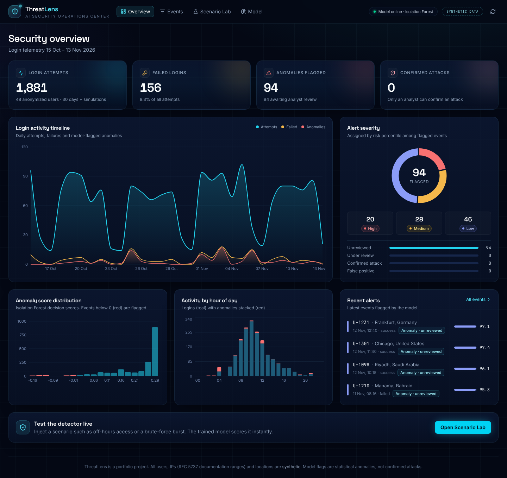
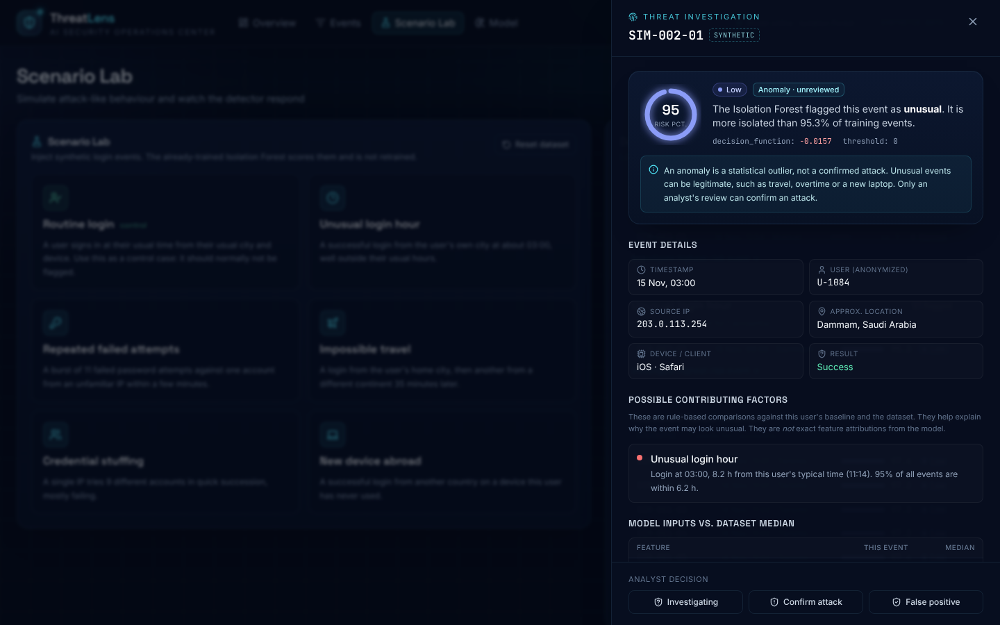
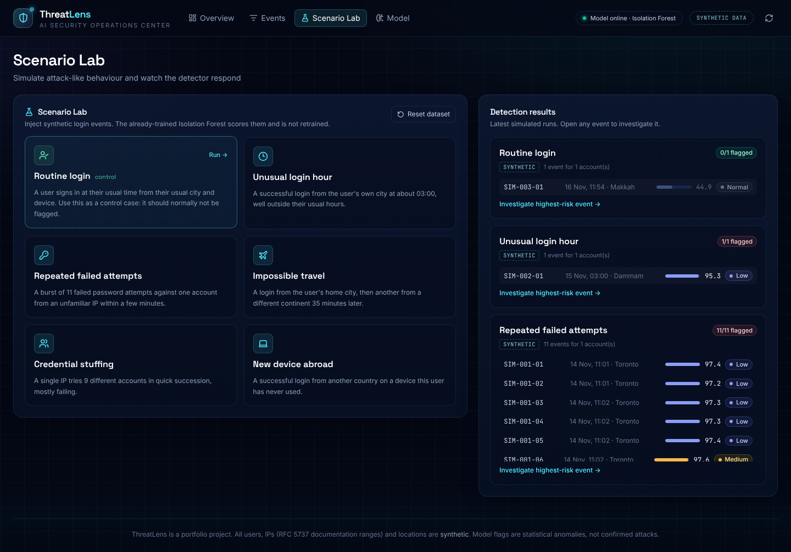
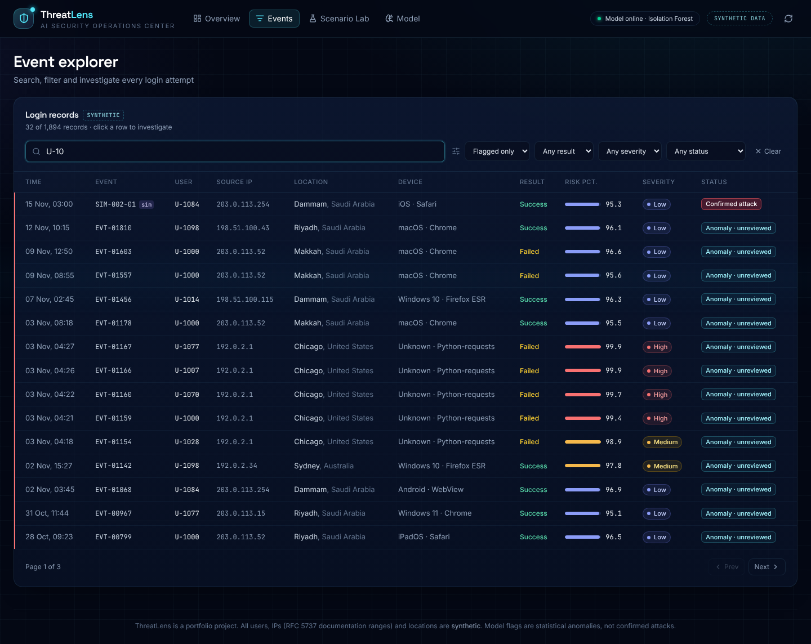
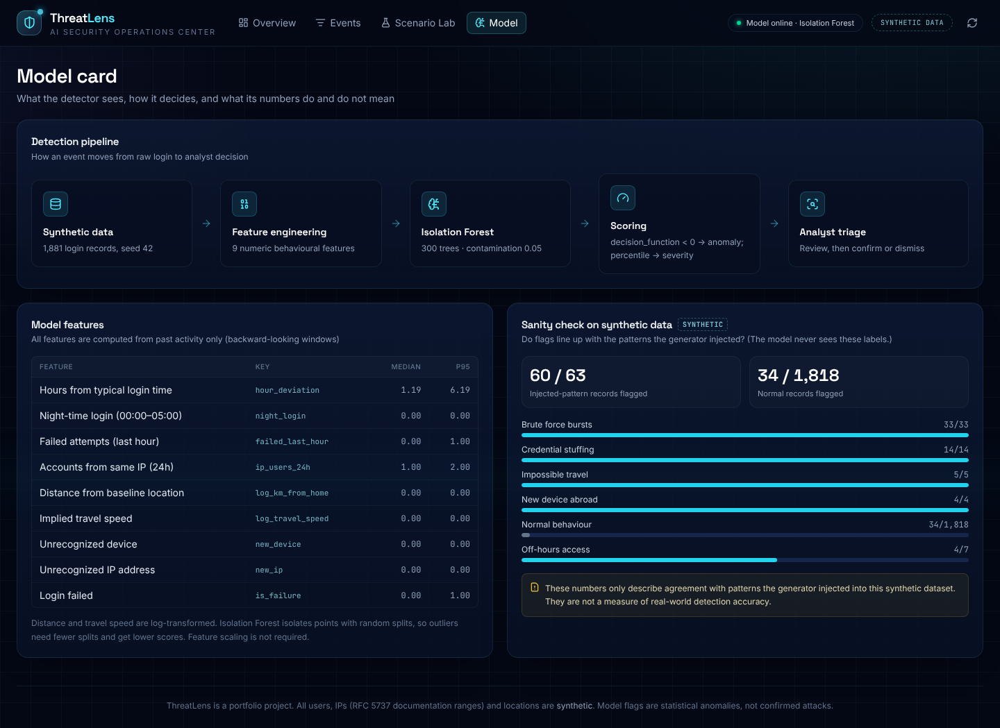

# ThreatLens: AI Security Operations Center

ThreatLens detects **suspicious login activity** with an unsupervised machine-learning model (scikit-learn **Isolation Forest**). It presents the results in a SOC-style dashboard where an analyst can search events, investigate alerts and record decisions.

> **All data is synthetic.** Users are anonymized IDs (`U-1000`…). IP addresses come from the RFC 5737 documentation ranges (`192.0.2.0/24`, `198.51.100.0/24`, `203.0.113.0/24`), and locations are approximate city centres. No real people or systems are represented.



## Features

- **Security dashboard**: login attempts, failed logins, model-flagged anomalies, analyst-confirmed attacks, activity timeline, anomaly-score distribution, hourly activity, alert severity and recent alerts.
- **Real anomaly detection**: an Isolation Forest (300 trees, `random_state=42`) is trained on 9 behavioural features computed from 1,881 synthetic login records.
- **Threat investigation**: click any event to see its details, risk percentile, raw `decision_function` score, rule-based contributing factors, model inputs compared with dataset medians, the user's baseline and recent history.
- **Anomaly ≠ attack**: the model only flags *unusual* events. An event becomes a **confirmed attack** only when an analyst marks it so (Investigating → Confirm attack / False positive).
- **Scenario Lab**: inject new events (routine control, unusual hour, repeated failures, impossible travel, credential stuffing, new device abroad). The already-trained model scores them live and is **not** retrained.
- **Event explorer**: full-text search plus filters for result, flag, severity and triage status, with pagination.
- **Model card**: pipeline, features with medians/p95, and a sanity check against injected synthetic patterns, with clear caveats.

## Architecture

```
frontend/  React 19 + TypeScript + Tailwind CSS v4 + Recharts (Vite dev server, proxies /api)
   │  fetch /api/*
backend/   FastAPI
   ├─ app/data.py   seeded synthetic data generator (users, logins, injected patterns)
   ├─ app/model.py  feature engineering · IsolationForest · rule-based explanations
   └─ app/main.py   REST API, triage state, scenario simulation
```

**Features used by the model** (all backward-looking, so no future information leaks in):

| Feature | Meaning |
|---|---|
| `hour_deviation` | Circular distance (hours) from the user's typical login time |
| `night_login` | Login between 00:00 and 05:00 |
| `failed_last_hour` | User's failed attempts in the preceding hour |
| `ip_users_24h` | Distinct accounts attempted from the same IP in 24 h |
| `log_km_from_home` | log(1 + km from the user's baseline city) |
| `log_travel_speed` | log(1 + implied km/h since the user's previous login) |
| `new_device` / `new_ip` | Device or IP not in the user's known set |
| `is_failure` | The attempt failed |

**Scoring.** `decision_function < 0` → flagged as an anomaly (contamination = 5%). The *risk percentile* is the event's rank among training scores, and it sets the severity of flagged events (High ≥ 99, Medium ≥ 97.5, otherwise Low).

**Explanations.** The "possible contributing factors" are transparent rule-based comparisons against the user's baseline and dataset percentiles. They help an analyst reason about an alert, but they are **not** exact feature attributions from the model.

**About the numbers.** The model card reports how many generator-injected patterns were flagged. That figure only describes agreement on this synthetic dataset. It is **not** a measure of real-world detection accuracy.

## Run locally

Requirements: Python 3.10+ and Node.js 18+. No API keys or paid services.

```bash
# 1) Backend  (http://127.0.0.1:8000, docs at /docs)
cd backend
python -m venv .venv && source .venv/bin/activate   # Windows: .venv\Scripts\activate
pip install -r requirements.txt
uvicorn app.main:app --port 8000

# 2) Frontend (http://localhost:5173), in a second terminal
cd frontend
npm install
npm run dev
```

Open http://localhost:5173. The dataset and model are rebuilt on every backend start (seed 42, so the results are identical). **Reset dataset** in the Scenario Lab clears simulated events and triage decisions.

## Tests

```bash
cd backend
python -m pytest -q
```

The 17 backend tests cover:
- dataset reproducibility and synthetic-only IPs
- summary consistency, and flags matching `decision_function < 0`
- the model card and its caveat
- event detail and explanations
- the triage workflow, including invalid input
- scenario injection: attack-like scenarios get flagged, the routine control does not, and existing scores don't change
- reset

## API

| Method | Path | Description |
|---|---|---|
| GET | `/api/summary` | KPIs, timeline, distributions, recent alerts |
| GET | `/api/events` | All scored login records |
| GET | `/api/events/{id}` | Event detail, factors, comparisons, user baseline |
| POST | `/api/events/{id}/triage` | `{"status": "reviewing" \| "confirmed" \| "dismissed" \| "new"}` |
| GET | `/api/scenarios` | Available simulation scenarios |
| POST | `/api/simulate` | `{"scenario": "brute_force"}`: inject and score new events |
| GET | `/api/model` | Model parameters, features, synthetic sanity check |
| POST | `/api/reset` | Regenerate the dataset and model |

## Limitations

- Synthetic data cannot capture the messiness of real authentication logs.
- Isolation Forest flags *rarity*, not *maliciousness*. Rare legitimate behaviour (travel, overtime) will be flagged, and attacks that look ordinary will not.
- Triage decisions are kept in memory only.

## Screenshots

| Investigation | Scenario Lab |
|---|---|
|  |  |

| Events | Model card |
|---|---|
|  |  |
